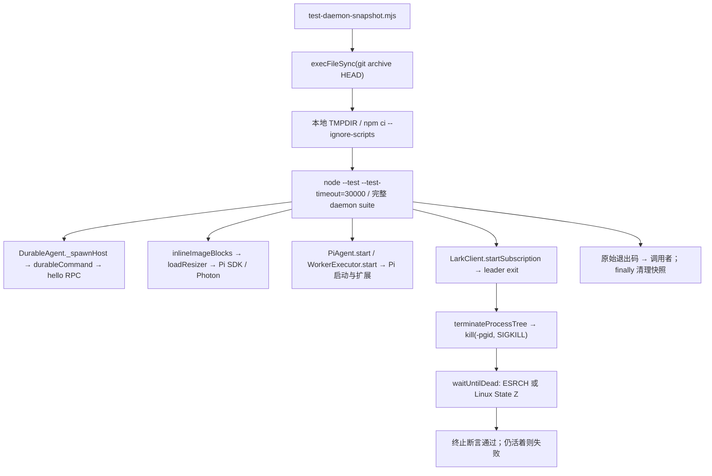

# PR #35：daemon 回归修复与复现

原始审计对象是 `413cc7b35e80b9962762946ac410179337641365`，共 1,054 项：1,034 通过、7 失败、4 取消、9 跳过。排查使用 Node v24.22.2，不改生产服务、模型凭据或教师反馈入口。

## 两个根因

### 10 项超时：依赖位于 Windows 共享盘

该环境 `/workspace` 挂载类型为 `9p`（Windows D:），`/tmp` 为 Linux 本地 overlay。durable、图片和 Worker 的独立重现进程在模块导入阶段停在 `p9_client_rpc`。原提交单独运行一个 faux durable 用例耗时 138 秒，其中 host 启动仍超过原有 20 秒期限；图片和 Worker 分别耗时 112/140 秒后报告原有 30 秒超时。假模型和假 CLI 不依赖真实 API key。

将同一提交、同一锁文件放到 `/tmp` 并重新安装依赖，四个文件全部 36/36 通过，原 10 个超时对应条目全部通过。原提交的本地全量回归也自然退出：1,045 通过、1 失败、0 取消、8 跳过，唯一失败仍为 Lark 的僵尸判定。增加的一个通过是本地安装后可执行的 Lark CLI version 冒烟测试。

修复方式是提供 `npm run test:daemon:snapshot`：用 `git archive` 导出当前已提交的仓库（包括教案复评集成测试所需的 Python 评测器），在系统临时目录安装锁定依赖，再执行完整 daemon suite。它保留 30 秒测试期限、durable 的 20 秒启动期限和 Pi 启动对话的 5 秒期限，不排除任何测试，不复制 checkout 的 node_modules、未跟踪文件或凭据。无论通过或失败都会清理临时副本；非零测试状态会传给调用者。

### 1 项断言：已终止的 orphan 被误判成运行

`LarkClient.startSubscription()` 在 leader 退出后通过 `terminateProcessTree(child, 'SIGKILL')` 杀原进程组。现场 `/proc/<descendant>/status` 是 `State: Z (zombie)`、`PPid: 1`；容器 PID 1 是 `sleep`，不回收孤儿。`kill(pid, 0)` 对僵尸仍成功，因此旧测试一直等待 PID 消失并失败。进程组终止已经生效，僵尸不能再执行。

测试现在在 Linux 同时接受 `/proc` 的 Z 状态，并保留其他平台的 ESRCH 判断。新增反例证明活进程不会被当成终止。另做临时故障注入，丢弃负 PID 的进程组信号后，更新后的同一断言仍失败，证明没有掩盖真正的活进程泄漏。故障注入没有提交到仓库。

## 函数与执行逻辑



源码映射：

- [快照入口](../../vika/scripts/test-daemon-snapshot.mjs)；[命令注册](../../vika/package.json)。
- [DurableAgent._spawnHost](../../vika/packages/daemon/src/durable.mjs)、[durableCommand](../../vika/packages/daemon/src/durable-runtime.mjs)。
- [inlineImageBlocks / loadResizer](../../vika/packages/daemon/src/inline-images.mjs)。
- [PiAgent](../../vika/packages/daemon/src/pi.mjs)、[WorkerExecutor](../../vika/packages/daemon/src/worker-executor.mjs)。
- [LarkClient.startSubscription](../../vika/packages/daemon/src/lark.mjs)、[POSIX terminateProcessTree](../../vika/packages/daemon/src/platform/posix.mjs)、[waitUntilDead 与进程组测试](../../vika/packages/daemon/test/lark.test.mjs)。

## 逐项验收

| 原异常 | 验收用例 | 修复后 |
|---|---|---|
| durable 1 | faux model turn and note | 通过 |
| durable 2 | Core tool through actions.sock | 通过 |
| durable 3 | register Core OpenViking tools | 通过 |
| durable 4 | coding tools commands and edits | 通过 |
| durable 5 | resume after host killed | 通过 |
| durable 6 | cancel then next turn in same host | 通过 |
| Lark 7 | terminate leftover subscriber descendants | 通过 |
| 图片 8 | large-image Pi resize and aspect ratio | 通过 |
| Pi/MCP 9 | discover tools, image and freshness fence | 通过 |
| Pi/MCP 10 | reject startup interactive dialog | 通过 |
| Worker 11 | Pi JSON print and worker authority | 通过 |

带修复的本地全量直接运行：1,055 项，1,047 通过、0 失败、0 取消、8 跳过，59.2 秒自然退出。比原 suite 多一个活进程反例。8 个跳过为 6 个 Windows 专属测试、live OV 配置测试和未安装 Slack 二进制的测试。

快照入口对实现提交 `d807958` 的最终运行：1,055 项，1,046 通过、0 失败、0 取消、9 跳过，59.3 秒自然退出。它使用与原回归相同的 `--ignore-scripts`，所以 Lark CLI version 冒烟测试也按原条件跳过；新增的跳过并非上述 11 项之一。临时目录已自动清理。

Lark 单文件 21/21；评测器 Python 12/12；语法检查通过。快照入口的失败路径通过临时 npm 替身验证：安装返回 17 时，入口也返回 17，并清理临时目录。

## 复现

提交本地改动后，在 `vika/` 目录运行：

```sh
TMPDIR=/tmp npm run test:daemon:snapshot
```

`TMPDIR` 必须在 Linux 本地盘，不能再指向 `/workspace`、`/mnt/c` 等共享挂载。该入口验证 HEAD，不包含尚未提交的改动。测试标准输出可重定向留档。平时在本地 Linux checkout 中仍可直接执行：

```sh
npm ci --ignore-scripts --no-audit --no-fund
node --test --test-timeout=30000 packages/daemon/test/*.test.mjs
```

这次只验收原有运行时回归和假评测闭环。真实 SciEval 评分质量、教师人工实测、生产环境部署仍按原计划分别处理。
